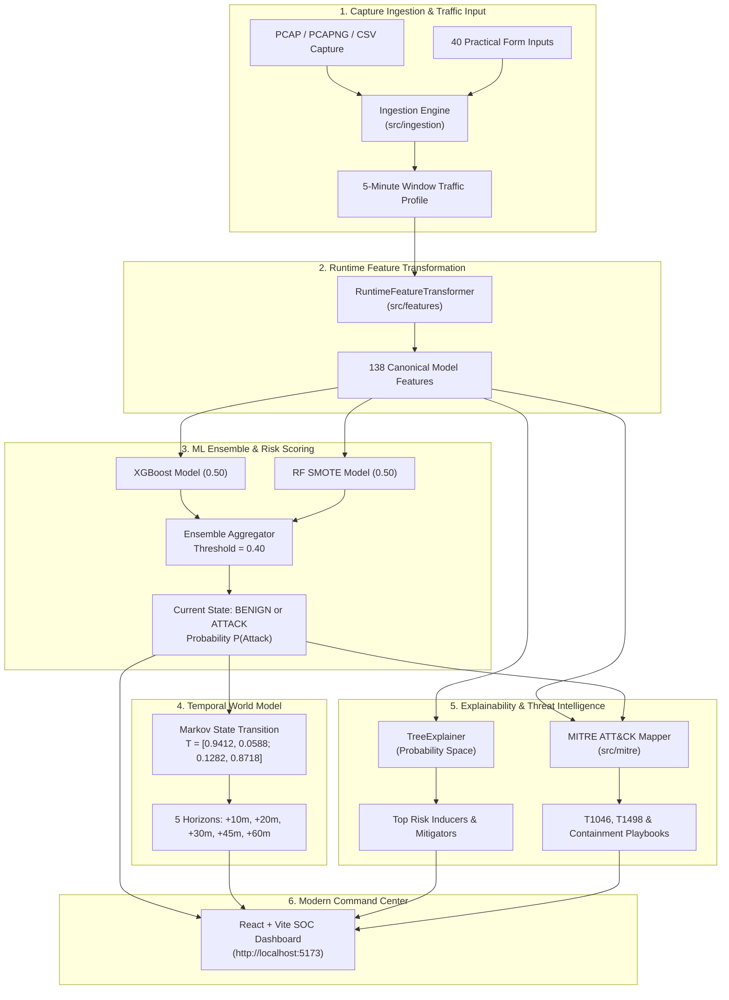

# NetVision AI — Documentation Hub & Technical Sitemap

Welcome to the **NetVision AI (SIH26153)** documentation hub. This directory contains the complete technical architecture, API references, mathematical derivations, empirical research findings, operational guidelines, and component specifications for the NetVision AI Network Attack Forecasting System.

---

## 1. Quick Navigation by Role

- **For SOC Analysts & Operators**:
  - [Operations & Unified Runner Guide](file:///C:/Users/Asus/Documents/GitHub/NetVision-AI-SIH26153/NetVision-AI-SIH26153/docs/operations/runner_and_testing_guide.md)
  - [Frontend Architecture & Cyber Command Center](file:///C:/Users/Asus/Documents/GitHub/NetVision-AI-SIH26153/NetVision-AI-SIH26153/docs/architecture/frontend_architecture.md)
  - [MITRE ATT&CK Mapping & Playbooks](file:///C:/Users/Asus/Documents/GitHub/NetVision-AI-SIH26153/NetVision-AI-SIH26153/docs/architecture/mitre_framework.md)
- **For API & Integration Engineers**:
  - [Forecasting API Reference](file:///C:/Users/Asus/Documents/GitHub/NetVision-AI-SIH26153/NetVision-AI-SIH26153/docs/api/forecast_api.md)
  - [Capture Ingestion API Reference](file:///C:/Users/Asus/Documents/GitHub/NetVision-AI-SIH26153/NetVision-AI-SIH26153/docs/api/file_ingestion_api.md)
  - [Capture File Ingestion Architecture](file:///C:/Users/Asus/Documents/GitHub/NetVision-AI-SIH26153/NetVision-AI-SIH26153/docs/architecture/file_ingestion.md)
- **For Machine Learning & Data Scientists**:
  - [Machine Learning Architecture](file:///C:/Users/Asus/Documents/GitHub/NetVision-AI-SIH26153/NetVision-AI-SIH26153/docs/architecture/ml_architecture.md)
  - [Runtime Input Design & 138-Feature Expansion](file:///C:/Users/Asus/Documents/GitHub/NetVision-AI-SIH26153/NetVision-AI-SIH26153/docs/architecture/runtime_input_design.md)
  - [Temporal World Model & Markov Propagation](file:///C:/Users/Asus/Documents/GitHub/NetVision-AI-SIH26153/NetVision-AI-SIH26153/docs/architecture/world_model.md)
  - [Probability-Space SHAP Explainability (XAI)](file:///C:/Users/Asus/Documents/GitHub/NetVision-AI-SIH26153/NetVision-AI-SIH26153/docs/architecture/xai_architecture.md)
  - [Dataset Specification (CSE-CIC-IDS2018)](file:///C:/Users/Asus/Documents/GitHub/NetVision-AI-SIH26153/NetVision-AI-SIH26153/docs/datasets/cic_ids2018.md)
- **For Researchers & Evaluators**:
  - [Research Methodology](file:///C:/Users/Asus/Documents/GitHub/NetVision-AI-SIH26153/NetVision-AI-SIH26153/docs/research/methodology.md)
  - [Research Gap Analysis](file:///C:/Users/Asus/Documents/GitHub/NetVision-AI-SIH26153/NetVision-AI-SIH26153/docs/research/research_gap.md)
  - [Literature Survey](file:///C:/Users/Asus/Documents/GitHub/NetVision-AI-SIH26153/NetVision-AI-SIH26153/docs/literature/literature_survey.md)
  - [Empirical Results & Model Comparison](file:///C:/Users/Asus/Documents/GitHub/NetVision-AI-SIH26153/NetVision-AI-SIH26153/docs/results/model_comparison.md)

---

## 2. Master Documentation Sitemap

```
docs/
├── README.md                                    # This hub & master index
├── PROJECT_COMPLETE_TECHNICAL_DOCUMENTATION.md  # Comprehensive monolithic technical guide
│
├── api/                                         # REST API & Ingestion contracts
│   ├── forecast_api.md                          # /forecast, /health, /forecast/file schemas & examples
│   └── file_ingestion_api.md                    # /preprocess/file multipart ingestion API
│
├── architecture/                                # Core architectural designs & components
│   ├── system_architecture.md                   # End-to-end multi-layer pipeline architecture
│   ├── ml_architecture.md                       # XGBoost + RF ensemble design & training decisions
│   ├── world_model.md                           # Discrete-Time Markov World Model (10m-60m horizons)
│   ├── mitre_framework.md                       # MITRE ATT&CK behavioral mapping & SOC playbooks
│   ├── xai_architecture.md                      # Probability-Space SHAP attribution & TreeExplainer
│   ├── runtime_input_design.md                  # 40 practical inputs -> 138 model features expansion
│   ├── file_ingestion.md                        # CSV/PCAP flow aggregation, windowing & tolerance
│   ├── frontend_architecture.md                 # React + Vite dashboard & glassmorphic design system
│   └── deployment_architecture.md               # Containerization, systemd, and production hosting
│
├── operations/                                  # Execution, test suites, and troubleshooting
│   └── runner_and_testing_guide.md              # run_all.py 7-phase runner & 34 pytest test cases
│
├── datasets/                                    # Training & evaluation datasets
│   └── cic_ids2018.md                           # CSE-CIC-IDS2018 profile, labels & distribution
│
├── research/                                    # Academic & experimental design
│   ├── methodology.md                           # Phased research methodology & evaluation metrics
│   ├── research_gap.md                          # Analysis of existing IDS vs proactive forecasting
│   └── research_decisions.md                    # Architectural decision log & trade-off rationale
│
├── literature/                                  # Related work & scientific papers
│   ├── literature_survey.md                     # Comprehensive academic literature review
│   ├── paper_1.md                               # Analysis of intrusion detection survey
│   ├── paper_2.md                               # Multi-step attack prediction review
│   └── paper_3.md                               # Explainable AI in cybersecurity review
│
└── results/                                     # Benchmark evaluation & performance metrics
    ├── baseline_results.md                      # Baseline single-model benchmarks
    ├── model_comparison.md                     # Comparative performance (XGB, RF, Ensemble)
    ├── forecasting_results.md                  # Multi-step Markov forecasting accuracy
    └── xai_results.md                           # SHAP feature attribution & validation results
```

---

## 3. System High-Level Data Flow



---

## 4. Key Architectural Standards & Constants

- **Canonical Features**: Exactly 138 temporal network statistics ([`src/ingestion/constants.py`](file:///C:/Users/Asus/Documents/GitHub/NetVision-AI-SIH26153/NetVision-AI-SIH26153/src/ingestion/constants.py)).
- **Practical Profile Inputs**: 40 standard network parameters exposed in UI and REST schemas.
- **Ensemble Decision Threshold**: `0.40` (calibrated for high recall against subtle, low-volume reconnaissance).
- **Ensemble Weights**: `50% XGBoost + 50% Random Forest SMOTE`.
- **Observation Window**: Exactly 5 minutes (300 seconds), aligned with standard network monitoring intervals.
- **Forecasting Horizons**: 5 discrete steps covering up to 60 minutes ahead.
