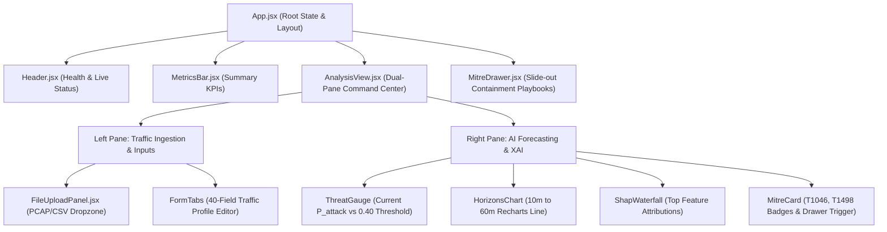

# NetVision AI — Frontend Architecture & UI Design System

## 1. Executive Summary

The NetVision AI frontend is an interactive **Cyber Command Center Dashboard** built with **React 18**, **Vite**, and **Tailwind CSS**. It is designed specifically for Security Operations Center (SOC) analysts to evaluate real-time network threat forecasts, inspect probability-space SHAP attributions, navigate multi-step Markov horizons, and ingest live network captures.

The interface adheres to modern SOC visualization standards: high-contrast dark mode, reactive glassmorphic panels, clear color-coded threat states (emerald green for Benign, crimson red for Attack), and responsive metric visualizations using **Recharts**.



---

## 2. Directory Structure & Component Hierarchy

The frontend source code is organized under [`frontend/src/`](file:///C:/Users/Asus/Documents/GitHub/NetVision-AI-SIH26153/NetVision-AI-SIH26153/frontend/src/):

```
frontend/src/
├── App.jsx                     # Root application container & global state
├── main.jsx                    # Vite entrypoint & ReactDOM mount
├── index.css                   # Tailwind CSS imports & global dark styles
├── components/
│   ├── layout/
│   │   ├── Header.jsx          # Top navigation bar, connection status, engine health
│   │   └── MetricsBar.jsx      # Top-level KPI cards (Total Flows, Risk Index, Latency)
│   ├── analysis/
│   │   ├── AnalysisView.jsx    # Primary command center layout
│   │   ├── FileUploadPanel.jsx # Drag-and-drop file ingestion dropzone
│   │   ├── RadarView.jsx       # Multi-dimensional signal radar chart (Recharts)
│   │   └── MitreDrawer.jsx     # Slide-out drawer with mitigation playbooks
│   └── common/
│       ├── Badge.jsx           # Status & severity badges
│       ├── Card.jsx            # Glassmorphic container wrapper
│       └── Tooltip.jsx         # Contextual guidance tooltips
├── services/
│   ├── api.js                  # FastAPI REST client (forecast, health)
│   └── upload.js               # Multipart file upload client (preprocess, file forecast)
└── utils/
    ├── constants.js            # Thresholds, default profiles, API endpoints
    └── trafficFields.js        # Metadata definitions for the 40 practical input fields
```

---

## 3. Core Component Specifications

### 3.1 `AnalysisView.jsx` — Primary Command Center
The central view orchestrates a dual-pane responsive layout:
- **Left Panel (Inputs)**:
  - Toggles between **File Upload Ingestion** and **Manual Traffic Profile Configuration**.
  - Categorizes the 40 practical inputs into six logical tabs:
    1. *Volumes & Counts*: `flow_count`, `forward_packets`, `backward_packets`, `forward_bytes`, `backward_bytes`.
    2. *Rates*: `flow_bytes_per_sec`, `flow_packets_per_sec`, `backward_packets_per_sec`.
    3. *Packet Sizes*: `fwd_pkt_len_mean`, `bwd_pkt_len_mean`, `pkt_len_max`, `pkt_len_min`.
    4. *Inter-Arrival Times (IAT)*: `flow_iat_mean`, `fwd_iat_mean`, `bwd_iat_mean`, `flow_duration`.
    5. *TCP Flags & Headers*: `syn_flag_cnt`, `ack_flag_cnt`, `psh_flag_cnt`, `fwd_header_len`.
    6. *Window & Diversity*: `init_fwd_win_byts`, `unique_dst_ports`, `unique_protocols`.
- **Right Panel (Forecasting Intelligence)**:
  - **Threat Status Card**: Displays instantaneous $P(\text{Attack})$, classification badge (`BENIGN` or `ATTACK`), and margin against the $0.40$ threshold.
  - **Horizons Trendline**: Recharts multi-step projection (+10m, +20m, +30m, +45m, +60m).
  - **Probability SHAP Waterfall**: Horizontal bar chart showing positive (risk-inducing) and negative (risk-mitigating) feature contributions.
  - **MITRE Tactics Card**: Badges displaying detected technique IDs (`T1046`, `T1498`). Clicking triggers `MitreDrawer.jsx`.

### 3.2 `FileUploadPanel.jsx` — Network Capture Dropzone
- Implements an interactive dropzone supporting `.csv`, `.pcap`, and `.pcapng` up to 200 MB.
- Provides real-time upload progress bars and parsing feedback.
- When multi-window captures are parsed, displays a **Window Carousel / Selector** allowing the analyst to inspect and forecast any 5-minute slice across the capture.

### 3.3 `MitreDrawer.jsx` — Slide-out Incident Playbook
- Slide-over panel presenting tactical CTI information:
  - Technique Name, ID, and Parent Tactic.
  - Active behavioral signals that triggered the mapping.
  - Operational Interpretation and Defensive Limitations.
  - Step-by-step SOC Containment Actions (e.g. firewall CLI snippets, rate limit configs).

---

## 4. State Management & Data Flow

The application relies on React's native state primitives (`useState`, `useCallback`, `useEffect`) without heavy external state libraries:

1. **Global App State (`App.jsx`)**:
   - `engineHealth`: Polled periodically from `GET /health`.
   - `trafficProfile`: Holds the active 40-parameter dictionary.
   - `forecastResult`: Holds the latest JSON response from `POST /forecast` or `POST /forecast/file`.
   - `isAnalyzing`: Boolean loading state controlling skeleton loaders and disabled states.
2. **File Ingestion Flow**:
   - Dropping a file triggers `uploadCaptureFile()` in `upload.js`.
   - Ingestion response contains parsed observation windows, summary statistics, and synthesized profiles.
   - Selecting a window updates `trafficProfile` and immediately triggers `forecastResult` rendering.

---

## 5. Styling & Visual Design System

- **Color Palette**:
  - Background: Deep slate / obsidian (`#0b0f19`, `bg-slate-950`).
  - Surface Panels: Glassmorphism translucent slate with borders (`bg-slate-900/60`, `backdrop-blur-md`, `border-slate-800`).
  - Threat State:
    - Benign: Emerald green (`text-emerald-400`, `bg-emerald-500/10`, `border-emerald-500/20`).
    - Attack: Vivid red / crimson (`text-rose-500`, `bg-rose-500/10`, `border-rose-500/20`).
  - Accents: Electric cyan (`#06b6d4`) and indigo (`#6366f1`).
- **Typography & Icons**:
  - Monospace font (`font-mono`) for network metrics, IP addresses, ports, and probabilities.
  - Vector icons provided by `lucide-react` (`ShieldAlert`, `Activity`, `Terminal`, `UploadCloud`, `Clock`).
