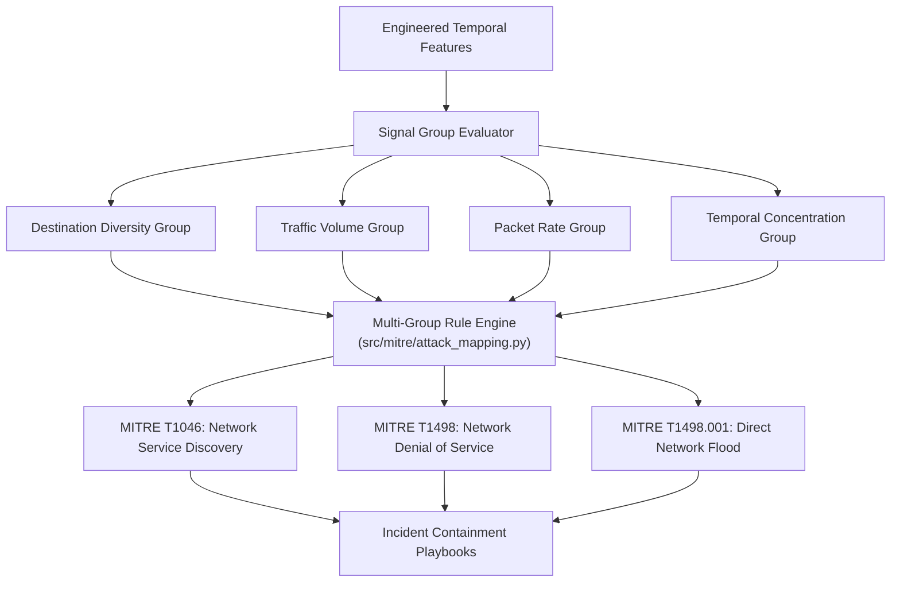

# NetVision AI — MITRE ATT&CK Behavioral Mapping Architecture

## 1. Executive Summary

NetVision AI integrates **MITRE ATT&CK** behavioral mapping into its core forecasting pipeline. Rather than treating intrusion alerts as opaque black-box probability scores, the system correlates observable network traffic signals with standard adversary Tactics, Techniques, and Procedures (TTPs).

This bridges the gap between **Machine Learning predictions** and **actionable Cyber Threat Intelligence (CTI)**, equipping Security Operations Center (SOC) engineers with standard technique identifiers (`T1046`, `T1498`, `T1498.001`) and defensible containment playbooks.



---

## 2. Core Design Principles

1. **Evidence-Based Multi-Signal Conjunction**:
   - A technique is **never** triggered by a single noisy metric.
   - Each MITRE technique requires a conjunction of distinct **behavioral signal groups** (e.g. Volume + Rate + Concentration) before being reported.
2. **Defensible Confidence Levels**:
   - Every technique mapping includes an explicit confidence score (`High`, `Medium`, `Low-Medium`, `Low`) based on signal density.
3. **Explicit Operational Limitations**:
   - Network flow features cannot inspect application payloads or verify adversary intent. Every mapping outputs documented boundaries to prevent analyst over-confidence.
4. **Actionable Containment Guidance**:
   - Each mapped technique provides immediate, field-proven containment steps (e.g. firewall rule templates, rate limits, ACL updates).

---

## 3. Behavioral Signal Groups

The mapper clusters features into four independent behavioral groups:

| Signal Group | Evaluated Model Features | Cyber Phenomenon Captured |
| :--- | :--- | :--- |
| **`destination_diversity`** | `unique_dst_ports`, `unique_protocols` | Port horizontal scans, multi-protocol probing, service sweep |
| **`traffic_volume`** | `flow_count`, `total_flow_count`, `Tot Fwd Pkts_sum`, `TotLen Fwd Pkts_sum` | High byte/flow concentration, bandwidth exhaustion |
| **`packet_rate`** | `Bwd Pkts/s_mean` | High-frequency packet transmission, stress on connection state tables |
| **`temporal_concentration`** | `Flow Duration_max` | Sustained connection flooding vs ephemeral probe bursts |

---

## 4. Supported MITRE ATT&CK Techniques

### 4.1 `T1046` — Network Service Discovery

- **Tactic**: Discovery (`TA0007`)
- **Required Signal Groups**: Requires at least **2** of:
  - `destination_diversity`
  - `traffic_volume`
  - `temporal_concentration`
- **Confidence**: `Medium`
- **Behavioral Rationale**:
  - Adversaries probe target networks across multiple destination ports and IP targets to identify active services, vulnerable software versions, and accessible entry points.
- **SOC Containment Playbook**:
  1. Inspect source IPs generating scanning traffic across port boundaries.
  2. Implement perimeter ingress filtering and restrict management interfaces (SSH, RDP, SMB).
  3. Verify honeypot tripwire alerts for early reconnaissance detection.

---

### 4.2 `T1498` — Network Denial of Service

- **Tactic**: Impact (`TA0040`)
- **Required Signal Groups**: Requires all **3** of:
  - `traffic_volume`
  - `packet_rate`
  - `temporal_concentration`
- **Confidence**: `Medium`
- **Behavioral Rationale**:
  - Adversaries generate extreme volumes of traffic targeting network infrastructure or intermediate appliances to degrade service availability and cause connection timeouts.
- **SOC Containment Playbook**:
  1. Activate upstream BGP flowspec or Cloud DDoS scrubbing mitigation.
  2. Apply rate-limiting at edge ingress routers for UDP/ICMP traffic.
  3. Scale auto-scaling groups behind load balancers and enable connection draining.

---

### 4.3 `T1498.001` — Direct Network Flood

- **Tactic**: Impact (`TA0040`)
- **Required Signal Groups**: Requires all **3** of:
  - `traffic_volume`
  - `packet_rate`
  - `temporal_concentration`
- **Confidence**: `Low-Medium`
- **Behavioral Rationale**:
  - Sub-technique of T1498 representing direct floods (e.g., SYN flood, ACK flood, UDP blast) directed against specific endpoints without amplification reflection.
- **SOC Containment Playbook**:
  1. Enable TCP SYN cookies on border firewalls and Linux reverse proxies (`sysctl -w net.ipv4.tcp_syncookies=1`).
  2. Drop spoofed packets failing Reverse Path Forwarding (uRPF).
  3. Enforce state table limits per source IP address.

---

## 5. Software Architecture & Implementation

The MITRE engine is implemented in [`src/mitre/attack_mapping.py`](file:///C:/Users/Asus/Documents/GitHub/NetVision-AI-SIH26153/NetVision-AI-SIH26153/src/mitre/attack_mapping.py):

```python
class MITREAttackMapper:
    """
    Correlates engineered temporal network features with MITRE ATT&CK techniques.
    """
    def map_traffic(self, features: dict[str, float], is_attack: bool) -> dict[str, Any]:
        if not is_attack:
            return {
                "status": "No mapped techniques (Traffic is Benign)",
                "techniques": []
            }

        active_groups = self._evaluate_signal_groups(features)
        mapped = []
        for tech_id, rule in self.TECHNIQUE_RULES.items():
            matching_groups = [g for g in rule["required_groups"] if g in active_groups]
            if len(matching_groups) >= rule["minimum_groups"]:
                mapped.append({
                    "technique_id": tech_id,
                    "technique_name": rule["technique_name"],
                    "tactic": rule["tactic"],
                    "confidence": rule["confidence"],
                    "active_signals": matching_groups,
                    "interpretation": rule["interpretation"],
                    "limitation": rule["limitation"]
                })

        return {
            "status": "MITRE ATT&CK mapping identified" if mapped else "No techniques matched",
            "techniques": mapped
        }
```

---

## 6. Defensive Limitations

1. **Absence of Payload Inspection**: NetVision AI inspects transport/flow headers. Encrypted malware C2 payloads inside TLS streams cannot be identified by signature.
2. **Flash Crowds vs Distributed DoS**: High traffic volumes caused by legitimate breaking events may exhibit characteristics resembling T1498; analysts should cross-reference server HTTP return codes (5xx vs 200).
