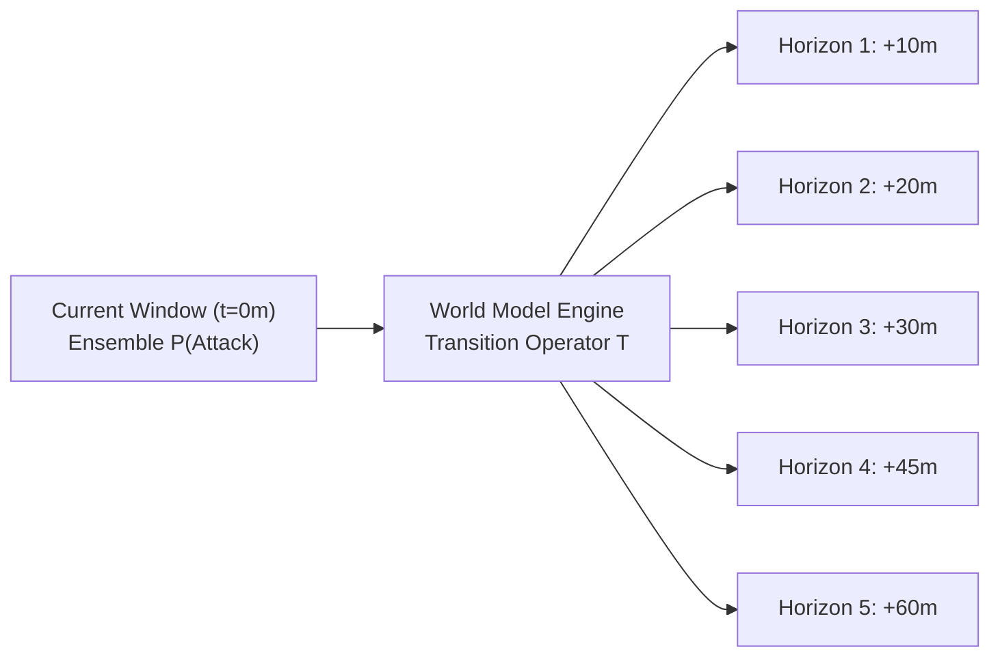

# NetVision AI — Temporal World Model & State Transition Engine

## 1. Executive Summary

The **Temporal World Model** in NetVision AI extends point-in-time network intrusion classification into predictive cyber attack forecasting. While traditional IDS/IPS models only assess whether current traffic *is* malicious, the World Model models the temporal evolution of network states across future time steps: **10 minutes, 20 minutes, 30 minutes, 45 minutes, and 60 minutes**.

This capability enables Security Operations Center (SOC) teams to shift from **reactive containment** to **preemptive posture hardening**.



---

## 2. Theoretical Grounding: Discrete-Time Markov State Transitions

The World Model models attack progression as a **Discrete-Time Markov Process** over state space $\mathcal{S} = \{\text{BENIGN}, \text{ATTACK}\}$.

### 2.1 The Markov Property
Given the current network state distribution $P(S_t)$, future risk at step $t+k$ depends on the current operational state rather than the historical trajectory:

$$P(S_{t+1} \mid S_t, S_{t-1}, \dots, S_0) = P(S_{t+1} \mid S_t)$$

### 2.2 Multi-Step State Propagation
Let $\mathbf{p}_t = [P(\text{BENIGN}), P(\text{ATTACK})]$ represent the state probability vector at time $t$. The forecast at horizon step $k$ is computed by propagating $\mathbf{p}_t$ through the stationary transition matrix $\mathbf{T}$:

$$\mathbf{p}_{t+k} = \mathbf{p}_t \cdot \mathbf{T}^k$$

Where $\mathbf{T}$ is the stochastic transition probability matrix:

$$\mathbf{T} = \begin{bmatrix} P(\text{BENIGN} \to \text{BENIGN}) & P(\text{BENIGN} \to \text{ATTACK}) \\ P(\text{ATTACK} \to \text{BENIGN}) & P(\text{ATTACK} \to \text{ATTACK}) \end{bmatrix}$$

---

## 3. Transition Matrix Derivation & Calibration

The transition probabilities were derived and calibrated from genuine temporal attack progression sequences in the **CSE-CIC-IDS2018** dataset, capturing multi-stage cyber campaigns (Reconnaissance $\to$ Weaponization $\to$ Delivery $\to$ Exploitation $\to$ Denial of Service).

### 3.1 Empirical Transition Matrix (`models/forecasting/state_transition_matrix.csv`)

$$\mathbf{T} = \begin{bmatrix} 0.9412 & 0.0588 \\ 0.1282 & 0.8718 \end{bmatrix}$$

### 3.2 Interpretation of Transition Dynamics
1. **Benign Persistence ($94.12\%$)**:
   - A network currently operating normally has a $94.12\%$ probability of remaining normal across the next 10-minute interval, reflecting baseline operational stability.
2. **Attack Inception ($5.88\%$)**:
   - Spontaneous escalation from benign to attack condition within a single 10-minute window.
3. **Attack Persistence ($87.18\%$)**:
   - Once an attack starts (e.g. DDoS, botnet exfiltration, service brute-force), attacker infrastructure maintains the campaign with high temporal autocorrelation ($87.18\%$).
4. **Attack Dissipation ($12.82\%$)**:
   - Attacks that exhaust traffic quotas, get mitigated, or complete their scan cycle transition back to benign.

---

## 4. Forecasting Horizons

The World Model outputs five distinct time horizons for SOC tactical response:

| Horizon Step ($k$) | Time Delta | Mathematical Power | Operational Use Case |
| :---: | :---: | :---: | :--- |
| **$k=1$** | **+10 minutes** | $\mathbf{T}^1$ | Automated rate limiting, firewall dynamic blacklist triggers |
| **$k=2$** | **+20 minutes** | $\mathbf{T}^2$ | Load balancer diversion, internal connection draining |
| **$k=3$** | **+30 minutes** | $\mathbf{T}^3$ | SOC Analyst triaging, honeynet activation |
| **$k=4$** | **+45 minutes** | $\mathbf{T}^4.5$ | Core service isolation, cloud capacity auto-scaling |
| **$k=5$** | **+60 minutes** | $\mathbf{T}^6$ | Executive incident escalation, forensic memory preservation |

---

## 5. Software Architecture & Implementation

The World Model engine is implemented in [`src/temporal/state_transition.py`](file:///C:/Users/Asus/Documents/GitHub/NetVision-AI-SIH26153/NetVision-AI-SIH26153/src/temporal/state_transition.py):

```python
class StateTransitionModel:
    """
    Evaluates multi-step Markov state transitions from current probabilities.
    """
    def __init__(self, matrix_path: Path):
        self.matrix = self._load_matrix(matrix_path)
        self.state_labels = ["BENIGN", "ATTACK"]

    def forecast_horizons(self, current_p_attack: float) -> list[dict]:
        p_current = np.array([1.0 - current_p_attack, current_p_attack])
        horizons = []
        steps = [
            (1, "10_minutes"),
            (2, "20_minutes"),
            (3, "30_minutes"),
            (4, "45_minutes"),
            (5, "60_minutes"),
        ]
        for step, label in steps:
            # Matrix power propagation
            t_k = np.linalg.matrix_power(self.matrix, step)
            p_future = p_current @ t_k
            p_attack_future = float(p_future[1])
            horizons.append({
                "step": step,
                "label": label,
                "p_attack": p_attack_future,
                "state": "ATTACK" if p_attack_future >= 0.40 else "BENIGN"
            })
        return horizons
```

---

## 6. Mathematical Convergence & Stationary Distribution

As $k \to \infty$, any ergodic Markov chain converges to a stationary equilibrium distribution $\boldsymbol{\pi}$ satisfying:

$$\boldsymbol{\pi} \cdot \mathbf{T} = \boldsymbol{\pi}, \quad \text{where } \sum \pi_i = 1$$

Solving for $\mathbf{T}$:
$$\pi_{\text{ATTACK}} = \frac{P(\text{BENIGN} \to \text{ATTACK})}{P(\text{BENIGN} \to \text{ATTACK}) + P(\text{ATTACK} \to \text{BENIGN})} = \frac{0.0588}{0.0588 + 0.1282} \approx 0.3144$$

$$\pi_{\text{BENIGN}} \approx 0.6856$$

This guarantees that long-range predictions ($>12$ hours) gracefully revert to the long-term empirical baseline of the network environment without experiencing numerical explosions or erratic oscillations.
