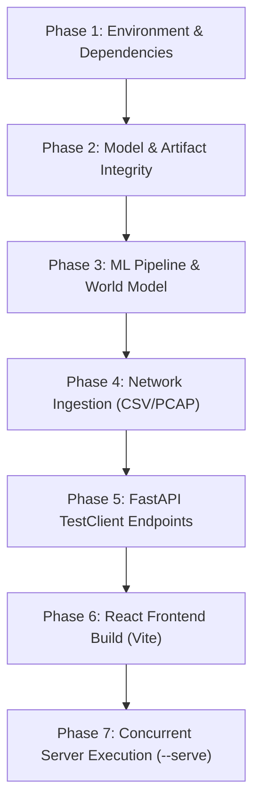

# NetVision AI — Operations, Unified Runner & Testing Guide

## 1. Overview

NetVision AI provides a unified orchestration and verification engine, [`run_all.py`](file:///C:/Users/Asus/Documents/GitHub/NetVision-AI-SIH26153/NetVision-AI-SIH26153/run_all.py), that automates environment audits, model artifact validation, ML pipeline scoring, network capture ingestion, FastAPI endpoints testing, and frontend production builds.

The system is designed to provide zero-friction setup and verification across both Windows and POSIX environments.

---

## 2. The Unified Runner (`run_all.py`)

### 2.1 Quick Start Commands

```powershell
# 1. Run all 7 verification phases end-to-end (approx. 5-10 seconds)
python run_all.py

# 2. Run verification without triggering the production npm build
python run_all.py --skip-build

# 3. Launch interactive servers (FastAPI on :8000 + React on :5173)
python run_all.py --serve

# 4. Custom host and port configuration
python run_all.py --serve --host 0.0.0.0 --port 8080 --frontend-port 3000
```

---

## 3. The 7 Execution Phases



### Phase 1: Environment & Dependency Verification
Audits Python runtime version ($\ge 3.10$) and verifies that all core numerical, ML, and network libraries are importable and functional:
- `fastapi`, `uvicorn`, `pydantic`, `pandas`, `numpy`, `scikit-learn`, `xgboost`, `shap`, `joblib`, `scapy`.

### Phase 2: Model & Configuration Artifact Integrity
Checks the physical existence, file size, and loadability of all required serialized artifacts in `models/trained/`:
- `xgb_model.json` ($\sim 238\text{ KB}$)
- `rf_smote_model.pkl` ($\sim 954\text{ KB}$)
- `feature_names.json` (Exact 138 canonical feature list)
- `ensemble_config.json` (Threshold $0.40$, weights $0.50/0.50$)
- `state_transition_model.json` & `state_transition_matrix.csv`
- `shap_background.csv` ($50\text{ samples} \times 138\text{ features}$)

### Phase 3: Machine Learning & Forecasting Pipeline Execution
Performs dry-run programmatic inference through `AttackForecastPipeline`:
- Evaluates a known Benign scenario ($P_{\text{attack}} \approx 0.2968 \to \text{BENIGN}$).
- Evaluates a known Attack scenario ($P_{\text{attack}} \approx 0.5543 \to \text{ATTACK}$).
- Validates the 5 multi-step Markov horizons (10m, 20m, 30m, 45m, 60m).
- Computes probability-space SHAP attributions without NaN/Inf.
- Verifies MITRE ATT&CK mapping output structure.

### Phase 4: Network Capture Ingestion Engine (CSV & PCAP)
Tests the ingestion engine on raw synthetic flows:
- Ingests a raw CICFlowMeter CSV stream.
- Reconstructs 5-minute observation windows and synthesizes the 40-input practical profile.

### Phase 5: FastAPI Backend & HTTP Endpoints Test
Uses FastAPI's internal `TestClient` (Starlette ASGI) to execute live HTTP transactions against all primary endpoints:
- `GET /` $\to$ Returns 200 OK and service metadata.
- `GET /health` $\to$ Returns 200 OK and reports `models_loaded: true`.
- `POST /forecast` $\to$ Sends 40-field JSON profile and receives complete forecast payload.
- `POST /preprocess/file` $\to$ Sends multipart CSV and verifies window extraction.
- `POST /forecast/file` $\to$ Sends capture file and verifies end-to-end file forecasting.

### Phase 6: Frontend Production Build Validation
- Inspects Node.js runtime environment ($v18+$).
- Executes `npm run build` inside `frontend/` to ensure TypeScript/JSX compilation, asset bundling, and CSS purging succeed without build-breaking errors.

### Phase 7: Interactive Concurrent Server Execution (`--serve`)
When `--serve` is specified, launches two managed concurrent background processes:
1. **Backend**: `uvicorn backend.app.main:app --host 127.0.0.1 --port 8000 --reload`
2. **Frontend**: `npm run dev -- --host 127.0.0.1 --port 5173`
- Manages clean teardown on `Ctrl+C` / SIGINT.

---

## 4. Pytest Test Suite Architecture

The automated test suite contains **34 comprehensive unit and integration tests** located in [`tests/`](file:///C:/Users/Asus/Documents/GitHub/NetVision-AI-SIH26153/NetVision-AI-SIH26153/tests/):

```powershell
# Run the full test suite
python -m pytest tests/

# If using Anaconda with third-party plugin conflicts:
python -m pytest -p no:anchorpy tests/
```

### Test Modules Breakdown
| Test File | Cases | Scope |
| :--- | :---: | :--- |
| `tests/test_backend.py` | 1 | FastAPI lifespan, startup events, and health status |
| `tests/test_features.py` | 1 | Feature schema validation and ordering contracts |
| `tests/test_file_ingestion.py` | 15 | PCAP parsing, Scapy flow reconstruction, 186-column CSV acceptance, arbitrary column counts, partial profile defaults |
| `tests/test_ingestion_api.py` | 4 | Ingestion API endpoints, multipart error handling, file size limits |
| `tests/test_models.py` | 1 | XGBoost + RF ensemble probability fusion and thresholding |
| `tests/test_preprocessing.py`| 1 | Missing value imputation and numerical scaling checks |
| `tests/test_runtime_transformer.py` | 10 | 40-input to 138-feature expansion, physical MTU caps, flow rate formulas |
| `tests/test_temporal.py` | 1 | Discrete-time Markov chain matrix powers and horizon projection |

---

## 5. Troubleshooting & FAQ

### 1. `anchorpy` Pytest Conflict (Anaconda Environments)
- **Symptom**: `ModuleNotFoundError: No module named 'pytest_xprocess'` when running pytest.
- **Root Cause**: An unrelated Solana/Web3 package (`anchorpy`) installed in the global conda base registers an unconfigured pytest hook.
- **Solution**: Pass `-p no:anchorpy` to disable the conflicting hook:
  ```powershell
  python -m pytest -p no:anchorpy tests/
  ```

### 2. Scapy Npcap Warning on Windows
- **Symptom**: `WARNING: WinPcap is deprecated... or No libpcap provider found`.
- **Root Cause**: Scapy searching for raw network interface packet capturing drivers (Npcap/WinPcap).
- **Impact**: Pure offline PCAP/PCAPNG file reading uses Python file streams and does not require Npcap. The warning can be safely ignored.

### 3. Port Conflicts (`8000` or `5173` in use)
- **Symptom**: `[Errno 10048] error while attempting to bind on address ('127.0.0.1', 8000)`.
- **Solution**: Specify custom ports using `run_all.py --serve --port 8001 --frontend-port 5174`.
