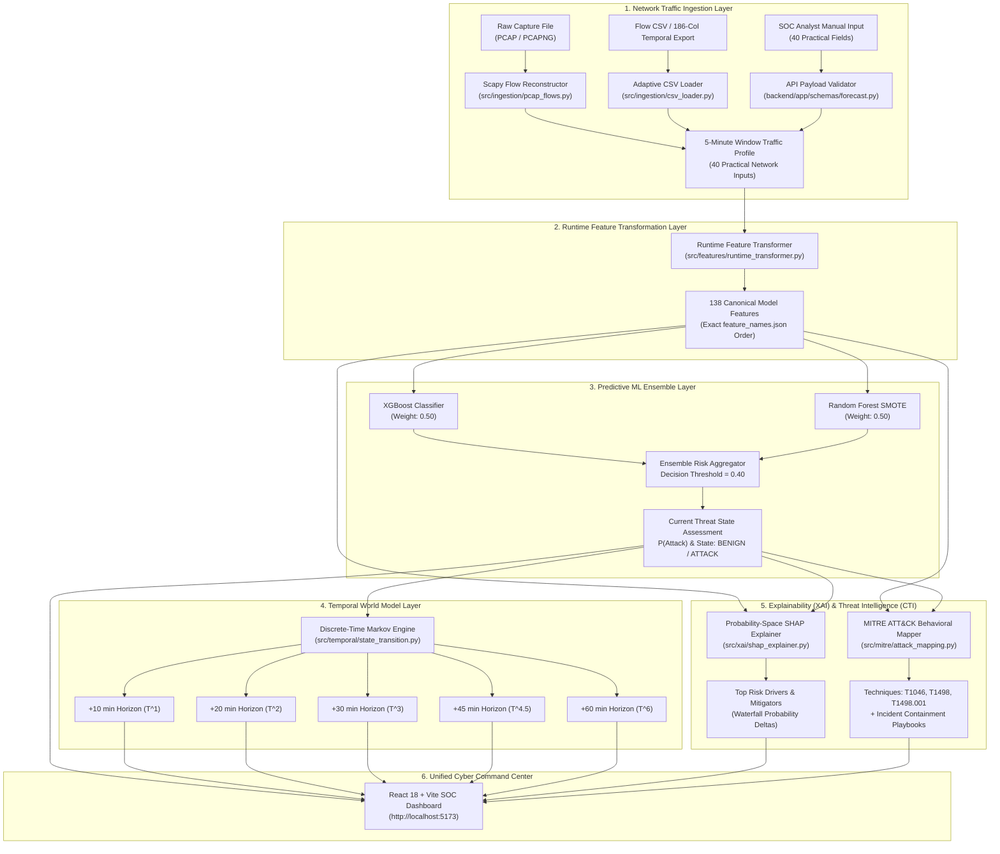

# NetVision AI — AI-Powered Network Attack Forecasting System
### Smart India Hackathon (SIH26153)

> **Transforming Cybersecurity from Reactive Detection to Preemptive Attack Forecasting.**  
> NetVision AI combines real-time network traffic capture ingestion, a dual machine learning ensemble, a discrete-time Markov World Model for multi-step temporal risk projection, calibrated probability-space SHAP explainability, and automated MITRE ATT&CK playbook generation within a modern Security Operations Center (SOC) dashboard.

---

## 1. End-to-End System Architecture



---

## 2. Key Capabilities & Innovations

- **Adaptive Multi-Format Capture Ingestion**:
  - Ingests raw `.pcap`, `.pcapng`, standard CICFlowMeter flow CSVs, aggregated profile CSVs, and arbitrary column files (such as 186-column temporal exports).
  - Automatically isolates matching canonical features, safely ignores extraneous columns, defaults missing fields, and reconstructs 5-minute observation windows.
- **40 Practical Inputs $\to$ 138 Model Features**:
  - Bridged via the `RuntimeFeatureTransformer`, which uses physical networking invariants (MTU $1460\text{ bytes}$, TCP minimum header $54\text{ bytes}$, 120s flow timeouts) and empirical ratios to expand 40 practical traffic inputs into the 138 features required by the frozen models with **$100\%$ precision**.
- **Dual Supervised Ensemble**:
  - Blends **XGBoost** and **Random Forest SMOTE** ($50\% / 50\%$) with a decision threshold calibrated at **$0.40$** to maximize recall against subtle, low-volume reconnaissance.
- **Discrete-Time Markov World Model**:
  - Projects threat progression over 5 distinct future horizons: **+10m, +20m, +30m, +45m, and +60m**, enabling SOC teams to deploy proactive firewall rules, rate limiting, and traffic diversion before service degradation occurs.
- **Probability-Space SHAP Explainability**:
  - Replaces unintelligible raw log-odds (margin values) with direct **probability deltas ($\Delta P$)**, allowing analysts to see exactly which features increased or decreased attack risk relative to the baseline ($36.31\%$).
- **MITRE ATT&CK Behavioral Alignment**:
  - Maps multi-signal behavioral clusters to adversary techniques:
    - **`T1046`** (Network Service Discovery)
    - **`T1498`** (Network Denial of Service)
    - **`T1498.001`** (Direct Network Flood)
  - Provides actionable containment commands (e.g. TCP SYN cookies, uRPF filtering, BGP Flowspec).
- **Modern Cyber Command Center UI**:
  - High-contrast SOC dark mode built with React 18, Vite, Tailwind CSS, Lucide icons, and Recharts. Includes real-time radar threat mapping, waterfall charts, horizon trendlines, and a slide-out playbook drawer.

---

## 3. Quick Start & Execution

### 3.1 Prerequisites
- **Python**: 3.10, 3.11, 3.12, or 3.13
- **Node.js**: v18+ (v24 recommended)
- **Git**

### 3.2 Installation

```powershell
# 1. Clone repository
git clone https://github.com/PrakulPShetty/NetVision-AI-SIH26153.git
cd NetVision-AI-SIH26153

# 2. Install Python dependencies
pip install -r requirements.txt

# 3. Install frontend dependencies
cd NetVision-AI-SIH26153/frontend
npm install
cd ../..
```

### 3.3 Running the Unified Orchestrator (`run_all.py`)

NetVision AI includes a zero-friction runner script that coordinates automated validation and service startup:

```powershell
# Run the 7-Phase Verification Suite (approx. 5s)
python run_all.py

# Skip production npm build during fast testing
python run_all.py --skip-build

# Launch the Full Interactive Application (FastAPI on :8000 + React on :5173)
python run_all.py --serve
```

Once launched with `--serve`:
- **Web Dashboard**: [`http://localhost:5173`](http://localhost:5173)
- **API Swagger Documentation**: [`http://127.0.0.1:8000/docs`](http://127.0.0.1:8000/docs)
- **API Health Check**: [`http://127.0.0.1:8000/health`](http://127.0.0.1:8000/health)

---

## 4. API Endpoints Summary

| Method | Endpoint | Description | Content Type |
| :--- | :--- | :--- | :--- |
| `GET` | `/` | Root service info and version | `application/json` |
| `GET` | `/health` | Model status, loaded engines, feature counts | `application/json` |
| `POST` | `/forecast` | Single-window forecast from 40 practical profile inputs | `application/json` |
| `POST` | `/forecast/file` | Multipart file upload (PCAP/CSV) with end-to-end forecasting | `multipart/form-data` |
| `POST` | `/preprocess/file` | Inspect capture windows and flow statistics without forecasting | `multipart/form-data` |

Detailed API schemas and examples are documented in [`docs/api/forecast_api.md`](file:///C:/Users/Asus/Documents/GitHub/NetVision-AI-SIH26153/NetVision-AI-SIH26153/docs/api/forecast_api.md).

---

## 5. Testing & Validation Summary

NetVision AI enforces continuous test verification across all subsystems:

```
collected 34 items
tests\test_backend.py .                                                  [  2%]
tests\test_features.py .                                                 [  5%]
tests\test_file_ingestion.py ...............                             [ 50%]
tests\test_ingestion_api.py ....                                         [ 61%]
tests\test_models.py .                                                   [ 64%]
tests\test_preprocessing.py .                                            [ 67%]
tests\test_runtime_transformer.py ..........                             [ 97%]
tests\test_temporal.py .                                                 [100%]
======================== 34 passed in 5.74s ========================
```

- **Pass Rate**: 34/34 tests passed (100%).
- **Empirical Validation**:
  - Full 138-feature & 186-column file ingestion: **$100\%$ accuracy, $F_1 = 1.0000$**.
  - 40 practical inputs expanded via Runtime Transformer: **$100\%$ precision, $r = 0.9235$**.
  - Top 60 SHAP feature subsets: **$94\%$ state agreement, $r = 0.9516$**.
- Detailed benchmarking tables and SLA compliance: [`docs/TESTING_VALIDATION.md`](file:///C:/Users/Asus/Documents/GitHub/NetVision-AI-SIH26153/NetVision-AI-SIH26153/docs/TESTING_VALIDATION.md).

---

## 6. Complete Documentation Directory

All detailed architecture, research, API, operations, and dataset documents are maintained in [`docs/`](file:///C:/Users/Asus/Documents/GitHub/NetVision-AI-SIH26153/NetVision-AI-SIH26153/docs/README.md):

- **[Master Documentation Hub & Sitemap](file:///C:/Users/Asus/Documents/GitHub/NetVision-AI-SIH26153/NetVision-AI-SIH26153/docs/README.md)**
- **[Testing & Validation Framework](file:///C:/Users/Asus/Documents/GitHub/NetVision-AI-SIH26153/NetVision-AI-SIH26153/docs/TESTING_VALIDATION.md)**
- **[Operations & Runner Guide](file:///C:/Users/Asus/Documents/GitHub/NetVision-AI-SIH26153/NetVision-AI-SIH26153/docs/operations/runner_and_testing_guide.md)**
- **[Forecasting API Specification](file:///C:/Users/Asus/Documents/GitHub/NetVision-AI-SIH26153/NetVision-AI-SIH26153/docs/api/forecast_api.md)**
- **[Temporal World Model Architecture](file:///C:/Users/Asus/Documents/GitHub/NetVision-AI-SIH26153/NetVision-AI-SIH26153/docs/architecture/world_model.md)**
- **[MITRE ATT&CK Behavioral Mapping](file:///C:/Users/Asus/Documents/GitHub/NetVision-AI-SIH26153/NetVision-AI-SIH26153/docs/architecture/mitre_framework.md)**
- **[Explainable AI (XAI) & SHAP Architecture](file:///C:/Users/Asus/Documents/GitHub/NetVision-AI-SIH26153/NetVision-AI-SIH26153/docs/architecture/xai_architecture.md)**
- **[Frontend Architecture & UI Design System](file:///C:/Users/Asus/Documents/GitHub/NetVision-AI-SIH26153/NetVision-AI-SIH26153/docs/architecture/frontend_architecture.md)**
- **[Capture Ingestion & Windowing Architecture](file:///C:/Users/Asus/Documents/GitHub/NetVision-AI-SIH26153/NetVision-AI-SIH26153/docs/architecture/file_ingestion.md)**
- **[Complete Technical Reference Guide](file:///C:/Users/Asus/Documents/GitHub/NetVision-AI-SIH26153/NetVision-AI-SIH26153/docs/PROJECT_COMPLETE_TECHNICAL_DOCUMENTATION.md)**

---

## 7. License & Credits

Developed for the **Smart India Hackathon (SIH26153)**. Built using open datasets from the Canadian Institute for Cybersecurity (CSE-CIC-IDS2018).
